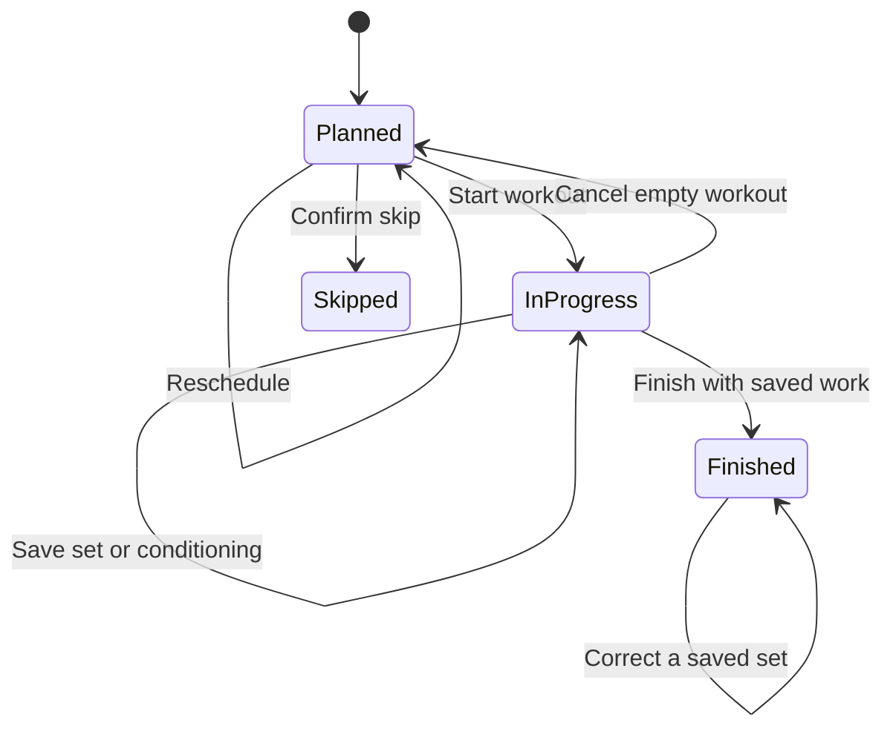

# UltimateCoach revival

For the later track and cycle design, see [Training tracks](TRAINING_TRACKS.md).

Reviewed from the September 2025 baseline at `d6cbe67`. The product direction is an offline workout companion for someone following a strength program. The central loop is to see the next workout, record what actually happened, and understand what the plan asks for next.

## Audit

| Priority | Finding | Outcome |
| --- | --- | --- |
| P0 | Tests failed to compile on Xcode 27.2 because the seed test used a main-actor SwiftData context from outside the actor. With the test isolated in a scratch copy, the existing rowing test reproduced `Zone4 46-30m`. | Swift 6 language mode, main-actor persistence tests, a shared scheme, and a corrected duration parser. |
| P0 | A 60 kg target displayed as 132.3 lb but saving it unchanged stored 27.2 kg. The progression engine also increased targets with no sets, partial sets, or sets performed at a lower weight. | Convert once at input and display boundaries. Require a full, valid set of results at the prescribed load for an increase. |
| P0 | Restore deleted the live program before a durable replacement existed. Reset could proceed after a failed or cancelled backup. | Preview and validate versioned backups. Save replacement together and roll back on failure. Remove the destructive reset shortcut. |
| P1 | First launch had several independent seed paths. The first log tap could present an empty sheet. | Seed only after choosing a date. Present the logger by selected exercise identity. |
| P1 | Today could silently select the oldest day when a plan ended. There was no session status, calendar browsing, or saved set correction. The timer disappeared with the sheet. | Today distinguishes current, upcoming, and finished workouts. Program exposes the schedule. Session status and the timer deadline persist locally. Progress opens saved sets for correction. |
| P1 | Selecting only the first day of the next week missed exercises on other days. Some exercises repeat at different prescriptions in the same week. | Compare the same template in the same weekly slot. Preserve intervening logged sessions and keep rest, phase, and targets distinct from actual results. |
| P2 | The README advertised automatic phase changes, scheduled deloads, and history beyond the implementation. | Document the working paths. Keep auto-periodization and conditioning progression in the coaching backlog pending a defined policy. |

[Baseline empty logger](evidence/baseline-blank-logger.png) · [Engine probe output](evidence/baseline-engine-output.txt). The app itself built with Xcode 27.2 before changes. Current compiler, SDK, simulator OS, and deployment target are independent. The repository never declared third-party packages. [Apple Xcode requirements](https://developer.apple.com/xcode/system-requirements)

## Functional design

| Screen | Main action | Supporting state |
| --- | --- | --- |
| Setup | Create the first program for today or choose another date | Explain the 12-week schedule and identify example loads as editable inputs. |
| Today | Open or resume the workout | Show a rest day with the next dated workout. If a workout is active, keep it available regardless of the new day. |
| Workout | Start, log, and finish | Separate planned prescriptions from results. A planned workout can move to an open date or be skipped. An empty active workout can be cancelled. Finishing with work remaining requires explicit confirmation. |
| Set log | Save the next set | Show current target, adjustable weight and reps, optional reps in reserve, and recent sets. Keep a full-width save action in reach. Allow correction with timestamps preserved. Set the starting load on each planned exercise and show why subsequent targets changed. |
| Program | Browse any week | Expose day, date, and status. Include missed workouts so a calendar change does not hide them. |
| Progress | Review a session or exercise | Show completed and partial workout history. Chart one best estimated 1RM per workout for qualifying loaded sets. Provide underlying set data as text. |
| Settings | Choose units, move future workouts, or manage backups | Use system settings patterns and explicit confirmation for replacement. |

Workout status belongs to a scheduled day. The published plan and recorded sets remain separate. Historical records with no session metadata stay readable through their set timestamps. A correction updates a suggestion only if the later exposures in its slot have yet to start. Archived or skipped days are visible in Program. Training records, including the new status and conditioning metrics, round-trip in backup v3. Restore also accepts earlier exports. The live rest timer expires based on a timestamp and is intentionally omitted from exports.

## Dark interface

Use graphite for the page, a lighter card surface, and lime for one primary action per action group. Keep native navigation, tab bars, and dialogs. Use system font sizes and text contrast, including distinguishable labels for complete, skipped, and in-progress states. Use full-width wrapping action buttons with a 48-point minimum height. Stack action pairs at accessibility sizes. Use scrollable sheet content with a fixed bottom save action. Avoid text truncation on long exercise names, labels, and dates. Verify iPhone portrait, compact width, the largest accessibility size, VoiceOver focus order, and iPad layout before release. [Apple accessibility guidance](https://developer.apple.com/design/human-interface-guidelines/accessibility) · [Apple guidance on adopting Liquid Glass](https://developer.apple.com/documentation/technologyoverviews/adopting-liquid-glass)

[Today](evidence/dark-today.png) · [Set logger](evidence/dark-set-logger.png) · [Logger at the largest accessibility text size](evidence/dark-largest-text.png)

## Delivery and acceptance

1. **Foundation and workout loop.** Build with Xcode 27.2 in Swift 6 mode. Protect save, restore, and schedule changes. Ship the dark interface through onboarding, workouts, program browsing, and progress. Validate normal and largest-text paths on an iPhone simulator and test a store from the original app.
2. **Coaching rules and program flexibility.** Define progression separately for loaded, assisted, and weighted bodyweight movements. Specify what a partial session, skipped session, and missing effort rating mean. Produce a reason for each recommendation and require confirmation before applying phase changes. Design a typed hypertrophy/strength state machine around reviewed entry/exit criteria. Test the same program through both transitions, insufficient data, manual override, and a correction. Add program-wide starting-load setup and exercise substitutions after deciding how substitutions inherit history.
3. **Release quality.** Review the new icon on device. Run VoiceOver, Increase Contrast, Reduce Transparency, landscape, iPad, and hardware interruption checks. Verify the minimum supported and latest available iOS runtimes. Confirm bundle ownership, produce a signed archive, review App Store privacy disclosures, and run a small TestFlight pilot. Recheck Apple submission requirements before upload. [Apple submission guidance](https://developer.apple.com/app-store/submitting/)
4. **Follow demand.** Local reminders, Lock Screen rest timers, HealthKit export, Apple Watch, and optional iCloud sync are candidates once repeat use justifies their maintenance and permissions. Prioritize reliable on-device recovery before cloud sync.

Pilot success means a returning lifter can resume a workout, log a set with the intended weight, correct a mistake, understand what changed, and recover from a backup without help. Use the pilot to confirm the starting loads, schedule flexibility, and rest workflow before adding more timing and recommendation features.

## Verification

- Xcode 27.2 (27B52), Swift 6.4.2 compiler in Swift 6 language mode, and the iOS 27.2 SDK. The full simulator suite ran on an iPhone 17 Pro with iOS 26.0, the minimum supported release. The unsigned Release build also compiled for iPhone and iPad.
- The iPhone 17 Pro run passed 26 unit tests and 2 UI tests. Engine line coverage was 96.1% (172 of 179 lines). Tests exercise data replacement, legacy JSON, manual target preservation, progression, session transitions, conditioning, and weight conversion. UI coverage follows setup, target editing, start, logging, resume, finish, and correction from history. The accessibility test opens the logger and saves a set at the largest text size. The same test also passed on the narrower iPhone 16e simulator, and its screenshot is linked above.
- The original audit simulator store opened with the additive schema and retained 1 program, 48 training days, and 228 prescribed exercises. That store contained no set history. The backup regression separately checks actual set and conditioning records.
- Calculated contrast for enabled text is 8.5:1 for secondary text on the card surface and 13.4:1 for primary button text. Native navigation and disabled-state rendering should also get a physical-device accessibility pass.
